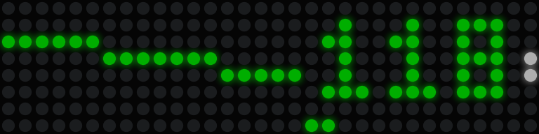
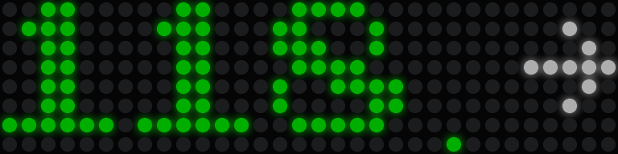
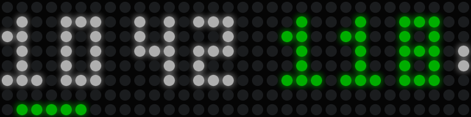
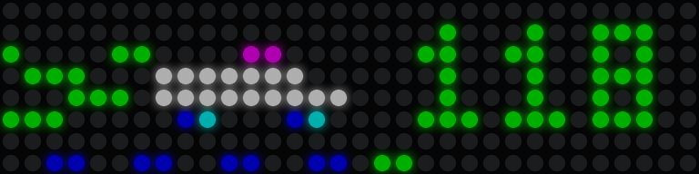
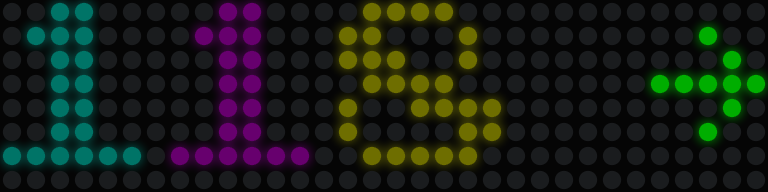
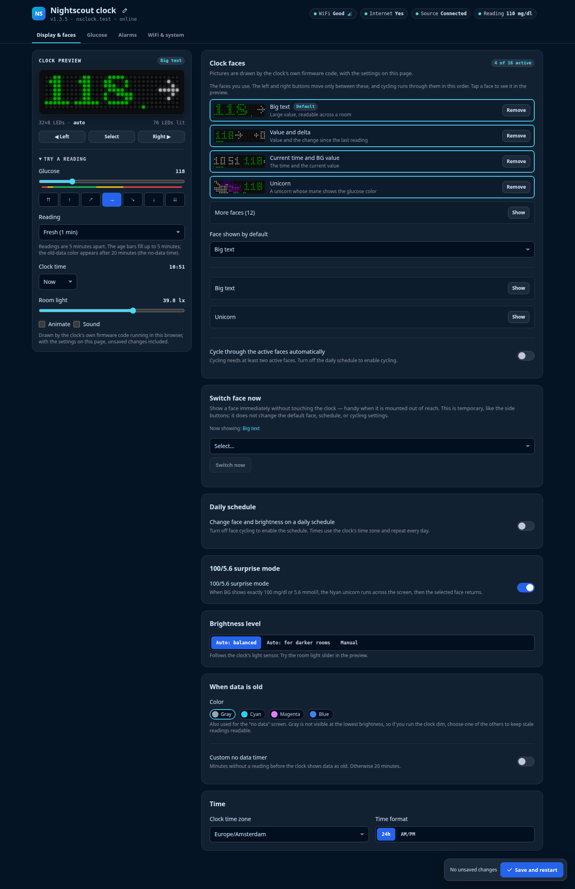
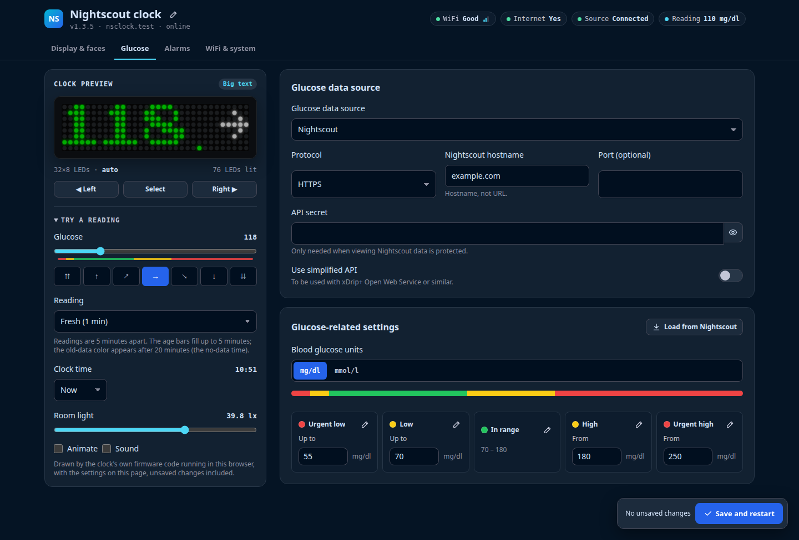
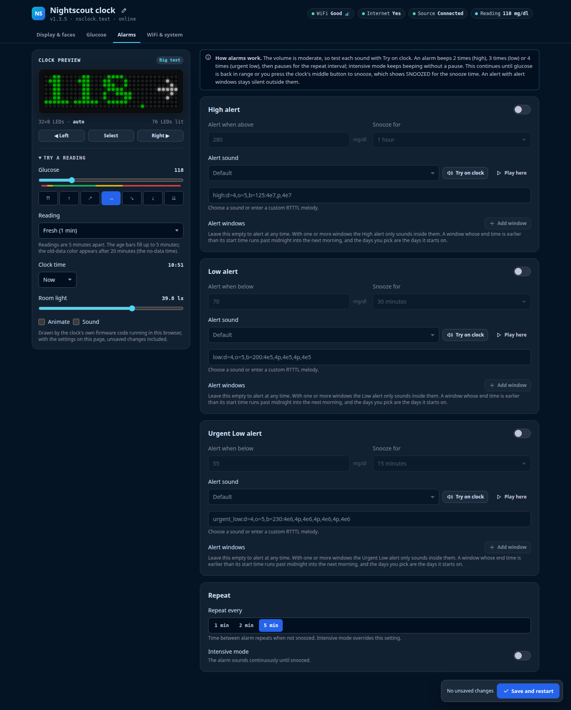
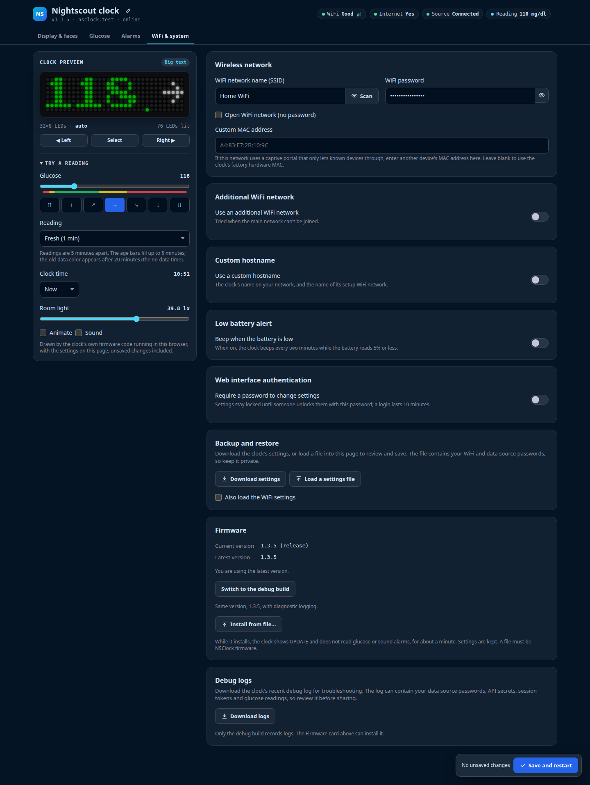

# Nightscout Clock


This is an active and developing project, new versions land every few weeks

### Current version: 1.3.5


_Nightscout Clock (or NSClock) is an open-source product aimed at helping caregivers of people with type 1 diabetes have peace of mind by being able to better monitor their loved ones' blood glucose values._

**Website: [nsclock.app](https://nsclock.app/)**, where you can install the firmware from your browser and try every clock face in the simulator.


## Here is what it can do

- 16 clock faces, including animated characters, rainbow faces, dark-room layouts, and a time-only face
- Can get glucose data from Dexcom Share, Nightscout, LibreLink Up or Medtrum EasyFollow
- Supports mg/dl and mmol/l
- 10 minutes setup through web browser
- Configurable low/high limits
- Audible alarms in case the blood sugar is too low or too high
- Automatic brightness adjustment
- Marks stale readings with a configurable color and a cross instead of the trend arrow
- Daily face and brightness schedules, or automatic cycling through your chosen faces
- Offline configuration page with settings backup and restore
- Live preview of the display on the settings page, so you see changes before saving them. Try the faces without a clock in the [face simulator](https://nsclock.app/simulator/)
- ...and more

### YouTube review

[](https://www.youtube.com/watch?v=7GmDflLxqLs)

Thanks [@CallumMcK](https://github.com/CallumMcK)

## How to install

1. Buy [Ulanzi TC001](https://www.ulanzi.com/products/ulanzi-pixel-smart-clock-2882?aff=1191), it is about $50, so you don't have to sell a kidney, it is available both in US and Europe (Aliexpress sells it as well, for the same price)
2. Wait a few days for the delivery
3. Unpack, turn on (press on `<` and `>` buttons for a few seconds)
4. Connect the USB-C cable (comes with the clock) to your computer
5. Go to the [installation page](https://nsclock.app/#install)
6. Follow the instructions. If installation fails, see the [troubleshooting guide](TROUBLESHOOTING.md#installation) and the [installation troubleshooting discussion](https://github.com/ktomy/nightscout-clock/discussions/57).
7. Once the clock is installed, take out your phone and join `nsclock` wi-fi network. Then go to `http://192.168.4.1/`
8. Set up your device, provide the Wi-Fi network details, your Dexcom, Nightscout, LibreLink Up or Medtrum EasyFollow credentials, glucose warning limits and other parameters
9. You're all set, enjoy!

## How to update

Updates use a full reflash and reset the clock's settings. Make a note of your settings before updating. If your installed version has **Backup and restore**, download a settings file first; after updating, load it on the **WiFi & system** tab, review the settings, and select **Save and restart**. Include network settings when restoring your WiFi connection; the web login must be configured separately.

[](https://www.youtube.com/watch?v=7mFZJ7_EFN4)

Thanks [@CallumMcK](https://github.com/CallumMcK)

## Troubleshooting

If the clock does not install, connect to WiFi, show data, or keeps restarting, see the [troubleshooting guide](TROUBLESHOOTING.md). It also explains how to collect logs with the debug firmware when reporting an issue.

## More information

Nightscout Clock is a custom firmware for Ulanzi TC001. It can also run (with minor changes) on AWTRIX-Light custom hardware, so if you need a bigger display, feel free to research.

### Clockfaces

The pictures are rendered from the clock's own display code, the same code as the settings page's preview and the [face simulator](https://nsclock.app/simulator/), each showing 118 mg/dl, flat, a minute old, at 10:42. Animated faces are shown partway through their motion. To update them after changing a face, build the preview and run `node scripts/render_faces.mjs`; see CONTRIBUTING.md.

##### Simple


Horizontal bars in the bottom of the display<br />
indicate the time since the last reading<br />
No bars: less than one minute<br />
1..5 green bars: 1..5 minutes<br />
5 yellow bars: 6..19 minutes<br />
value and bars use the configured old-data color from 20 minutes (default threshold)<br />
and the trend arrow is replaced by an X in the same color

##### Full glucose graph


Three hours of readings across the panel.

##### Glucose graph and value



The dots on the right side replace the trend arrow.<br />
2 white dots = horizontal arrow.<br />
2 colored dots (white + green) = 45° arrow.<br />
3 dots = vertical arrow.<br />
4 dots = double arrow.<br />
Colored dots above = upward trend.<br />
Colored dots below = downward trend.

Dots under the value are the same as<br />
horizontal bars on the other faces.<br />
See "Simple" face for details

##### Big text



Age dots under the trend arrow show one dot per minute since the last reading, up to five; they turn yellow after five minutes and take the old-data color once data is old. They are on by default and can be turned off in the Big text drawer of the Clock faces card.

The value can also turn cyan, blue or magenta once the reading is 6, 10 or 15 minutes old, in a color different from the old-data color and the range colors. An urgent reading keeps its urgent color. The old-data color still takes over at the data-is-old threshold. Off by default; set it in the same drawer.

##### Value and delta


Value and the change since the last reading.

##### Current time and BG value



The dots on the right side replace the trend arrow.<br />
2 white dots = horizontal arrow.<br />
2 colored dots (white + green) = 45° arrow.<br />
3 dots = vertical arrow.<br />
4 dots = double arrow.<br />
Colored dots above = upward trend.<br />
Colored dots below = downward trend.

For the bottom-side bars see "Simple" face for details

##### Unicorn


A unicorn whose mane of stepped color bands breaks into dim tips: magenta to blue for normal readings, warning or urgent colors outside the configured limits (every other band darker), and the configured old-data color for stale readings. Age bars appear below the value. Contributed by [@JuanMiste](https://github.com/JuanMiste); the picture was redrawn with a larger head and a banded mane in [#201](https://github.com/ktomy/nightscout-clock/pull/201).

The mane is still by default; set it to moving (calm, normal or lively) in the Unicorn drawer of the Clock faces card, and choose how it moves: its colors flow down the bands, slide back toward the tips, or hold while a light runs along the bands. While the reading is fresh a low or high mane shows darker stripes, and in the outer quarter of the in-range, low or high band every third band of a moving mane takes the color of the band beyond that edge (green next to the in-range limit, the urgent color next to the urgent limit); dark stripes run past an urgent limit, and the mane stops in the old-data color when data is old.

##### Time only


Only the time: hours, minutes and seconds in 24-hour format, or hours, minutes and AM/PM in 12-hour format. Glucose is always hidden, including urgent readings and old or missing data. New glucose alarms are suppressed while this face is selected. Alarms already triggered, including snoozed alarms, continue normally.

##### Simple (dark)


Simple for a dark room: the number in one chosen color (white, cyan, blue or magenta, different from every range color, set in the Simple (dark) drawer of the Clock faces card), the trend arrow in the glucose range color, and no age bars. Urgent readings draw the number in the urgent color. Old data uses the old-data color.

##### Race car



A white race car speeds toward the value while speed lines stream past, the road slides back and the wheels spin. The speed lines show the glucose color: green in range; yellow with a darker stripe running through when low or high, with the urgent color mixed in near the urgent limit; and red with dark stripes past an urgent limit. For stale readings the whole race stops and is drawn faded, every other pixel, in the configured old-data color. Set the speed (calm, normal or lively) in the Race car drawer of the Clock faces card. Age bars appear below the value.

##### Dragon


A little dragon breathes fire at the value, with age bars below it. The flame is magenta, orchid, purple and violet in range, the Unicorn's colors, and takes the low or high color outside the limits, with a darker stripe, the urgent color mixed in near the urgent limit, and dark stripes past an urgent limit, as on the moving Unicorn mane. When data is old the fire goes out and the dragon is drawn faded in the old-data color. Set the flame's speed (calm, normal or lively) in the Dragon drawer of the Clock faces card.

##### Big text (dark)


Big text's large digits in the Simple (dark) number color, readable across a dark room, and the trend arrow in the glucose range color. Both dark faces share one number color setting. Big text's age dots are available too, off by default; turn them on in the Big text (dark) drawer of the Clock faces card.

##### Rainbow clock


The time with every character in a moving rainbow: hours, minutes and seconds in 24-hour format, or hours, minutes and AM/PM in 12-hour format. Like Time only, it always hides glucose and suppresses new alarms while selected; already-triggered and snoozed alarms continue normally. Contributed by [@adamecker](https://github.com/adamecker).

##### Rainbow big text



Big text's large digits, each in a moving full rainbow whatever the value, with the trend arrow in the glucose range color. Stale readings stop and use the old-data color. Contributed by [@adamecker](https://github.com/adamecker).

##### Rainbow mood


A smiley, the value in rainbow digits, and the trend arrow. The smiley takes the glucose range color and changes expression with it: happy in range, shocked when low or falling, dizzy when high. Stale readings stop and use the old-data color. Contributed by [@adamecker](https://github.com/adamecker).

##### Battery and uptime


The clock's battery level as a bar and a percentage, and the time since the clock started, in minutes, hours or days. It shows no glucose. Off by default; turn it on in the Clock faces card. Contributed by [@adamecker](https://github.com/adamecker).

#### Active clock faces

The Web UI's Clock faces card selects which faces are active. All of them except Battery and uptime are active out of the box; turning off the ones you never use shortens what the left and right buttons move between, and the default face is chosen among the active ones.

#### Automatic clock-face cycling

Automatic cycling can be enabled in the same card, and runs through the active faces in the order shown, so at least two of them must be active. Choose how often the face should change: 10 or 30 seconds, or 1, 2, 3, or 5 minutes.

While cycling is enabled, the left and right buttons restart the interval without stopping automatic cycling. The default-face setting is hidden until automatic cycling is turned off again.

#### Face and brightness schedule

The **Daily schedule** card on the **Display** tab can change the clock's face and brightness at up to eight times each day. Each row gives a time, an active face, and a manual brightness level or automatic mode. That selection lasts until the next row, including overnight. For example, use Big text in the morning and Simple at brightness 1 in the evening. The buttons still change the face between rows. Scheduling and automatic cycling cannot both be on; until the clock knows the time, it stays on its default face.

### Configuration web interface

The settings page works offline and adapts to desktop and phone screens. Four tabs group the controls; changes take effect when you select **Save and restart**. Use the pencil beside the heading to name your clock.

The screenshots below show the 1.1 settings interface with sample data, captured before the version bump.

#### Display

Choose active clock faces, face-specific colors and animations, automatic cycling or a daily schedule, brightness, old-data behavior, and time settings. While the clock has recent data, you can also switch to any face immediately.



#### Glucose

Connect your data source and configure glucose units, range limits, and colors.



#### Alarms

Configure high, low, and urgent-low alarms, including sounds, snooze durations, alert windows, and repeat behavior.



#### WiFi & system

Set up WiFi, an optional secondary network, a custom MAC address or hostname, an optional low battery alert, and web login protection. This tab also shows the firmware version and provides settings backup and restore.



The **Backup and restore** card downloads the clock's settings as a file and loads a file into the page for review before saving. WiFi settings are loaded only when requested; the web login is never imported. The file contains WiFi and data source passwords, so keep it private.

The **Low battery alert** switch, off by default, makes the clock beep every two minutes while the battery reads 5% or less.

### Alarm settings

High, low, and urgent-low alarms each have their own threshold, snooze duration, sound, and optional alert windows in the Web UI.

- Choose one or more alert windows by weekday and start/end time. With no windows, an enabled alarm can sound at any time. Windows use the clock's configured timezone; an overnight window starts on the selected weekday and continues into the next morning. If the clock has not obtained the time yet, it allows alarms regardless of their windows.
- Set the repeat interval to 1, 2, or 5 minutes (default). Intensive mode overrides this and repeats every 2 seconds.
- Choose the default sound, one of six sound presets, or a custom RTTTL melody. The **Try** button plays the current melody on the clock without saving, even if that alarm is disabled.

### Features (technical stuff, feel free to ignore)

- Web-based installation (no need to install flashing tools, you just need the clock and a web browser). The clock hosts a website where the user can configure all the parameters (data source, limits, alarms, display)
  - Access-Point mode to set the initial configuration
  - Support for a secondary WiFi (e.g. if you want to take the clock in your car for a long trip)
  - Support for WPA-Enterprise
  - Ability to set a custom hostname in case you have multiple NSClocks on the same network
  - A name for each clock (such as Kitchen or Bedroom), set with the pencil beside the Web UI heading and shown as the page heading and browser tab title
- Simple glucose value display with trend arrow
- Changing color based on limits. Each glucose range's color (red, yellow, green, yellow, red by default) can be changed next to its limit in the Web UI, and every face follows it
- Nightscout data source, the clock gets units type and value boundaries from Nightscout (see [how to](https://youtu.be/GGiep2gdx_o) set up using [Nightscout.pro](https://www.nightscout.pro/) as data source)
- [Juggluco](https://www.juggluco.nl/) data source (support for HTTP Nightscout endpoints)
- [Improv Wi-Fi](https://github.com/improv-wifi) compatibility (setting up WiFi during the installation)
- [Gluroo](https://gluroo.com/) data source (API_SECRET within the URL parameters) (see how to setup [video](https://youtu.be/unG-l6XXWxw))
- Simplified Nightscout API like xDrip+ [Open Web Service](https://github.com/NightscoutFoundation/xDrip/blob/master/Documentation/technical/Local_Web_Services.md) support. When adding it as a data source, choose Nightscout and check the `Simplified API` checkbox. Make sure your source device (e.g. your phone running xDrip) has a static IP address and is on the same WiFi network. Also don't forget to check the port setting; for xDrip it is usually `17580`
- Dexcom Share data source
- LibreLinkUp (libreview) data source
- Medtrum EasyFollow data source
- Medtronic users can bridge data through xDrip+ to Nightscout, then connect the clock to that Nightscout site. See [discussion #53](https://github.com/ktomy/nightscout-clock/discussions/53)
- Brightness adjustment
  - Brightness can be adjusted within the Web UI
  - Automatic brightness adjustment based on the ambient light
  - A single press of the middle button steps through `OFF`, `MIN`, `10%` to `100%`, `AUTO-1` (the Web UI's "Auto: balanced") and `AUTO-2` ("Auto: for darker rooms"), showing the choice for a moment; the change lasts until the clock restarts, and a long press restores the brightness set in the Web UI
  - When the display is off, a single press of the middle button turns it on at `MIN`, and a long press turns it on at the brightness set in the Web UI
- Multiple clock faces support
  - Default clock face can be selected in the Web UI
  - Clock faces can be changed using arrow buttons on the clock
  - Faces you do not use can be turned off in the Web UI
  - Active clock faces can cycle automatically at a configurable interval
  - Face and brightness can follow a daily schedule
  - Simple clock face (value and trend arrow)
  - Full-width glucose graph
  - Graph, value and trend indicator
  - BIG DIGITS, with age dots and an optional color for a late reading
  - Value, trend and delta
  - Clock and BG value (timezone is set in the clock's web interface)
  - Unicorn and glucose value, with mane colors based on glucose limits
  - Race car and glucose value, with speed lines in the glucose color
  - Time only, always hiding glucose and suppressing new alarms while selected; already-triggered alarms continue normally
  - Simple (dark): the number in a color of your choice with the glucose color on the trend arrow, for night
  - Dragon and glucose value, breathing fire in colors based on glucose limits
  - Big text (dark): the same with BIG DIGITS
  - Rainbow clock: the time in moving rainbow colors, hiding glucose and suppressing new alarms like Time only
  - Rainbow big text: BIG DIGITS in a moving rainbow
  - Rainbow mood: a smiley whose expression follows the glucose range, beside the value in rainbow digits
  - Battery and uptime: battery level and time since start, off by default
- 100/5.6 surprise mode: when a new reading shows exactly 100 mg/dl or 5.6 mmol/l, a Nyan unicorn runs across the screen once, then the selected face returns. It is on by default in new configurations; turn it off on the Display tab of the Web UI
- Configurable color for old readings and no-data screens: gray (default), cyan, magenta, or blue. Choose it on the Display tab of the Web UI; the alternatives help keep stale readings visible at low brightness
- Smart data and screen update timings: read data once it appears, refresh screen when needed
- API data source. The clock has a simple Nightscout-like API which can receive glucose values from an external source. The main purpose of this feature is the ability to test the clock during the clockfaces development. In order to activate this feature, select the API data source within the clock's Web UI. Here are the endpoints:
  - /api/v1/entries POST endpoint receives an array of Nightscout-like entries. The only significant fields are `sgv`, `date` and `trend` or `direction`. Due to the limited memory the API is stable when sent fewer than 10 records
  - /api/v1/entries DELETE endpoint deletes all entries regardless of the payload
- Firmware versioning
- Debug firmware keeps a log of recent debug messages that can be downloaded from the Debug logs card on the WiFi & system tab, so a clock can be diagnosed without a computer attached. The log can contain passwords, API secrets and glucose readings, so review it before sharing
- Alarms with configurable thresholds, snooze times, repeat interval, sounds, and weekday/time alert windows
- To turn the device on or off press both arrow buttons for 3 seconds
- To reset the device to factory defaults (hard reset) during boot sequence (when version number is displayed) keep the center (select) button pressed.

### My TODO list

- Add more clock faces
  - Humidity and temperature
- Smooth color change (rainbow) based on the value and boundaries
- Add more data sources
  - ...more... (if you are the author of a CGM data collecting app/service and you want your data to be displayed on the Nightscout Clock, please contact me)

## Changes

### 1.3.5

- Optimized memory use and made another attempt to fix LibreLinkUp connection issues

### 1.3.4

- Fixed the debug firmware printing the Medtrum session cookie in its log, which can be downloaded from the clock and is often shared in issues; the regular firmware was not affected
- Added memory and WiFi signal lines to the debug firmware's log: before and after each request to Nightscout, Dexcom, LibreLinkUp and Medtrum, and once a minute, to help find why connections to the glucose source fail after the clock has run for hours

### 1.3.3

- Added the WiFi signal strength to the settings page header: the WiFi status shows three bars with Strong, Good or Weak, and its tooltip gives the value in dBm; the network list in the WiFi settings now draws its bars the same way
- Improved the Nightscout connection error: a 401 answer now shows "Missing API secret" and a 403 answer "Invalid API secret" instead of the bare status code

### 1.3.2

- Fixed LibreLinkUp readings going missing for long stretches while the LibreLinkUp app showed them: a reading that reached LibreLinkUp after the clock's next poll was skipped for good, thanks [@nishanm](https://github.com/nishanm) for finding the cause ([#273](https://github.com/ktomy/nightscout-clock/issues/273))
- Fixed LibreLinkUp errors such as "Invalid LibreLinkUp glucose response: IncompleteInput" or "InvalidInput" stopping the clock after a single bad answer: the clock now keeps its readings and tries again, shows an error only after repeated failures, and shows the current reading when the history can't be loaded; the history now loads with much less memory, which was the usual reason for the cut-off answers ([#273](https://github.com/ktomy/nightscout-clock/issues/273))
- Changed the settings page to accept LibreLink Up passwords longer than 20 characters, thanks [@nishanm](https://github.com/nishanm) ([#284](https://github.com/ktomy/nightscout-clock/pull/284))
- Added the project website, [nsclock.app](https://nsclock.app/), with the browser installer and the face simulator; firmware releases are published as GitHub releases
- The README shows every clock face as rendered by the clock's own display code, and the settings page preview shows a charged battery on the Battery and uptime face, thanks [@nishanm](https://github.com/nishanm) ([#285](https://github.com/ktomy/nightscout-clock/pull/285))

### 1.3.1

- Changed how faces are chosen in the settings page: the active faces are listed at the top, each with its picture and a Remove button, and the other faces wait in a "More faces" gallery, closed by default, where you can preview and add them; the card's count shows how many faces are active, thanks [@nishanm](https://github.com/nishanm)
- Changed new configurations to activate four faces: Big text (the default), Value and delta, Current time and BG value, and Unicorn; the side buttons and face cycling move only between active faces, so after a fresh install they show these four until you add others from the "More faces" gallery

### 1.3.0

- Added a live preview of the clock to the settings page: it draws the selected face with your unsaved settings, its Left, Select and Right buttons work like the clock's, and a test reading lets you try values, trends, data age, clock time and room light; it warns when LEDs go dark at the chosen brightness and can play alarm melodies in the browser, thanks [@nishanm](https://github.com/nishanm) ([#206](https://github.com/ktomy/nightscout-clock/pull/206))
- Added the [face simulator](https://ktomy.github.io/nightscout-clock/simulator/), linked from the installer page, which previews every clock face in the browser using the same code as the clock, thanks [@adamecker](https://github.com/adamecker) ([#218](https://github.com/ktomy/nightscout-clock/pull/218)) and [@nishanm](https://github.com/nishanm) ([#206](https://github.com/ktomy/nightscout-clock/pull/206))
- Added a WiFi network scan to the settings page: the Scan button lists nearby 2.4 GHz networks by signal strength, and choosing one fills in the name and the open-network switch, thanks [@nishanm](https://github.com/nishanm) for the list layout ([#279](https://github.com/ktomy/nightscout-clock/pull/279), [#280](https://github.com/ktomy/nightscout-clock/pull/280))
- Changed mmol/L values and the Value and diff delta to match Nightscout's main view: mmol/L uses Nightscout's conversion factor (for example, 55 mg/dl now shows as 3.1 instead of 3.0), the delta is calculated the way Nightscout does, and mmol/L deltas always show one decimal place, such as +1.0; glucose limits entered in mmol/L in the settings page use the same conversion ([#276](https://github.com/ktomy/nightscout-clock/pull/276))
- Changed the Unicorn face to start with a moving mane in new configurations
- Fixed WiFi setup from the web installer hanging after the credentials were sent: the clock crashed after saving them and never reported the result; the installer now also shows an error instead of waiting forever if a reply is lost ([#278](https://github.com/ktomy/nightscout-clock/pull/278))
- Improved the contributor tooling: the firmware can run in the Wokwi simulator with scripted scenarios, and text files now use LF line endings throughout the repository

### 1.2.0

- Added the "Switch face now" card on the Display tab, showing any clock face immediately without touching the clock; like the side buttons, the switch is temporary and leaves the default face, schedule and cycling unchanged, thanks [@adamecker](https://github.com/adamecker) ([#232](https://github.com/ktomy/nightscout-clock/pull/232))
- Added the 100/5.6 surprise mode: a new reading shown as exactly 100 mg/dl or 5.6 mmol/l makes a Nyan unicorn run across the screen once, then the selected face returns; it is on by default in new configurations, thanks [@adamecker](https://github.com/adamecker) ([#222](https://github.com/ktomy/nightscout-clock/pull/222))
- Added an optional low battery alert on the WiFi & system tab: the clock beeps every two minutes while the battery reads 5% or less; it is off by default, because a worn-out or removed battery also reads 0%, thanks [@0m4r](https://github.com/0m4r) ([#267](https://github.com/ktomy/nightscout-clock/pull/267))
- Reworked the middle button: a press now steps through `OFF`, `MIN`, `10%` to `100%`, `AUTO-1` and `AUTO-2`, replacing the double-click for turning the display off; when the display is off, a press wakes it at `MIN` and a long press at the brightness set in the Web UI; a press that snoozes an alarm no longer changes the brightness
- Improved the Value and diff delta: in mmol/L it now always matches the two displayed values, instead of showing a false ±0.1 for readings that display the same; after a missed reading it shows the change scaled to five minutes, duplicate readings no longer produce a false zero, and it shows "?" when there is no usable previous reading or the jump is too big, thanks [@martinsuchan](https://github.com/martinsuchan) ([#168](https://github.com/ktomy/nightscout-clock/pull/168))
- Fixed a crash and restart on every start with LibreLinkUp ("Stack canary watchpoint triggered"), seen on the debug firmware since 1.1.1; the main loop now has a larger stack for the secure connection, thanks [@nishanm](https://github.com/nishanm) ([#260](https://github.com/ktomy/nightscout-clock/pull/260))
- Fixed scanning for networks over Improv disconnecting anyone using the setup access point, thanks [@0m4r](https://github.com/0m4r) ([#265](https://github.com/ktomy/nightscout-clock/pull/265))
- Fixed the "To API" message being clipped, and prepared the display code for faces that refresh more often than once a minute, thanks [@0m4r](https://github.com/0m4r) ([#268](https://github.com/ktomy/nightscout-clock/pull/268))
- The debug firmware now logs its version at boot and at the top of every downloaded debug log, thanks [@nishanm](https://github.com/nishanm) ([#262](https://github.com/ktomy/nightscout-clock/pull/262))
- Added host-side tests that run on every pull request, thanks [@0m4r](https://github.com/0m4r) ([#266](https://github.com/ktomy/nightscout-clock/pull/266))
- Improved the contributor tooling: helper scripts are executable, `build.sh` works on macOS, and the emulator and import scripts read the clock's address from an argument or a local file, thanks [@0m4r](https://github.com/0m4r) ([#263](https://github.com/ktomy/nightscout-clock/pull/263), [#264](https://github.com/ktomy/nightscout-clock/pull/264)); `ns_test_dataage.py` takes the Nightscout address as an argument ([#269](https://github.com/ktomy/nightscout-clock/pull/269))

### 1.1.2

- Attempted to fix LibreLinkUp still failing at start with "Error getting connections from LibreLinkUp: -11" for some users after 1.1.1; the login now closes its connection before the next request, thanks [@nishanm](https://github.com/nishanm) ([#259](https://github.com/ktomy/nightscout-clock/pull/259))

### 1.1.1

- Fixed LibreLinkUp failing right after login with "Error getting connections from LibreLinkUp: -11" for some users; each request now opens its own connection, thanks [@nishanm](https://github.com/nishanm) ([#258](https://github.com/ktomy/nightscout-clock/pull/258))
- Fixed a clock updated from 1.0.0 forgetting its default face, switched-off faces and scheduled faces; settings files saved from 1.0.0 now load them too, thanks [@nishanm](https://github.com/nishanm) ([#254](https://github.com/ktomy/nightscout-clock/pull/254))
- Fixed the settings page moving the clock to the phone's time zone when opened from a device in another zone, thanks [@nishanm](https://github.com/nishanm) ([#256](https://github.com/ktomy/nightscout-clock/pull/256))
- The settings page now refuses glucose limits that are out of order, which made in-range readings show as low, thanks [@nishanm](https://github.com/nishanm) ([#255](https://github.com/ktomy/nightscout-clock/pull/255))
- Kept the glucose state visible: Big text keeps the urgent color while a reading is late, the Unicorn mane keeps its warning and urgent colors at the lowest brightness, and the dark faces' number color is limited to white, cyan, blue or magenta, different from the range colors, thanks [@nishanm](https://github.com/nishanm) ([#257](https://github.com/ktomy/nightscout-clock/pull/257))

### 1.1.0

- Added the Rainbow clock face, showing the time in moving rainbow colors; like Time only, it hides glucose and suppresses new alarms while selected, thanks [@adamecker](https://github.com/adamecker) ([#241](https://github.com/ktomy/nightscout-clock/pull/241))
- Added the Rainbow big text face, with every large digit in a moving rainbow and the trend arrow in the glucose range color, thanks [@adamecker](https://github.com/adamecker) ([#242](https://github.com/ktomy/nightscout-clock/pull/242))
- Added the Rainbow mood face, with a smiley whose expression and color follow the glucose range beside the value in rainbow digits, thanks [@adamecker](https://github.com/adamecker) ([#243](https://github.com/ktomy/nightscout-clock/pull/243))
- Added the Battery and uptime face, showing the battery level and the time since start; it is off by default, thanks [@adamecker](https://github.com/adamecker) ([#248](https://github.com/ktomy/nightscout-clock/pull/248))
- Added age dots under the trend arrow to Big text (on by default) and Big text (dark) (off by default), thanks [@adamecker](https://github.com/adamecker) ([#245](https://github.com/ktomy/nightscout-clock/pull/245))
- Added middle-button brightness control: a single press steps through levels 1 to 10 and the automatic modes until the next restart, and a long press restores the saved brightness; also fixed the display staying dark after turning it off and on in manual brightness mode, thanks [@adamecker](https://github.com/adamecker) ([#219](https://github.com/ktomy/nightscout-clock/pull/219))
- Added a downloadable debug log to debug firmware, available from the Debug logs card on the WiFi & system tab, thanks [@adamecker](https://github.com/adamecker) ([#240](https://github.com/ktomy/nightscout-clock/pull/240))
- Fixed LibreLinkUp logins that require accepting updated terms of use; the clock now accepts the step and logs in again instead of showing a credentials error, thanks [@waldokilian2](https://github.com/waldokilian2) ([#237](https://github.com/ktomy/nightscout-clock/pull/237))
- Fixed repeated LibreLinkUp connection failures quickly leading to a fatal error and restart, thanks [@nishanm](https://github.com/nishanm) ([#247](https://github.com/ktomy/nightscout-clock/pull/247))
- Made the settings page load faster by checking internet reachability at most once a minute, thanks [@adamecker](https://github.com/adamecker) ([#234](https://github.com/ktomy/nightscout-clock/pull/234))
- Fixed the settings page keeping a scheduled time whose face the clock does not have, thanks [@nishanm](https://github.com/nishanm) ([#211](https://github.com/ktomy/nightscout-clock/pull/211))
- Switched clock faces to stable IDs, so new faces no longer compete for ID numbers ([#244](https://github.com/ktomy/nightscout-clock/pull/244))
- Fixed the build and release pipelines on the current GitHub runners

### 1.0.0

- Rebuilt the configuration page as a self-contained, offline UI with Display, Glucose, Alarms, and WiFi & system tabs, responsive layouts, and unsaved-change indicators; removed Bootstrap and jQuery dependencies, thanks [@nishanm](https://github.com/nishanm) ([#192](https://github.com/ktomy/nightscout-clock/pull/192))
- Added settings backup and restore: download a configuration file, load it for review, optionally include network settings, and save when ready; web login settings are never imported, thanks [@nishanm](https://github.com/nishanm) ([#197](https://github.com/ktomy/nightscout-clock/pull/197))
- Added daily face and brightness schedules with up to eight changes per day, including overnight use, thanks [@nishanm](https://github.com/nishanm) ([#190](https://github.com/ktomy/nightscout-clock/pull/190))
- Added active-face selection for button navigation, automatic cycling, default-face selection, and scheduling, thanks [@nishanm](https://github.com/nishanm) ([#195](https://github.com/ktomy/nightscout-clock/pull/195))
- Added the Time only face, which hides glucose and suppresses new alarms while selected; already-triggered and snoozed alarms continue normally, thanks [@nishanm](https://github.com/nishanm) ([#193](https://github.com/ktomy/nightscout-clock/pull/193))
- Added Simple (dark) and Big text (dark), sharing a configurable number color while retaining glucose-colored trend arrows and urgent/old-data colors, thanks [@nishanm](https://github.com/nishanm) ([#191](https://github.com/ktomy/nightscout-clock/pull/191), [#200](https://github.com/ktomy/nightscout-clock/pull/200))
- Added the Race car face with animated speed lines, road, and wheels, selectable animation speeds, and a stopped, faded scene for stale readings, thanks [@nishanm](https://github.com/nishanm) ([#203](https://github.com/ktomy/nightscout-clock/pull/203))
- Added the Dragon face with animated flames, selectable animation speeds, and extinguished fire for stale readings, bringing the total to 12 clock faces, thanks [@nishanm](https://github.com/nishanm) ([#202](https://github.com/ktomy/nightscout-clock/pull/202))
- Redrew the Unicorn and added optional mane animation, motion styles, speeds, and twinkling; the mane stops when readings become stale, thanks [@nishanm](https://github.com/nishanm) ([#201](https://github.com/ktomy/nightscout-clock/pull/201))
- Added configurable colors for all five glucose ranges, used throughout the clock faces and graphs, thanks [@nishanm](https://github.com/nishanm) ([#199](https://github.com/ktomy/nightscout-clock/pull/199))
- Added an optional early-stale color to Big text for readings 6, 10, or 15 minutes old; the old-data color takes precedence at the configured old-data threshold, thanks [@nishanm](https://github.com/nishanm) ([#178](https://github.com/ktomy/nightscout-clock/pull/178))
- Replaced stale trend arrows with a cross in the old-data color, thanks [@nishanm](https://github.com/nishanm) ([#194](https://github.com/ktomy/nightscout-clock/pull/194))
- Added editable clock names, shown in the settings heading and browser tab, thanks [@nishanm](https://github.com/nishanm) ([#196](https://github.com/ktomy/nightscout-clock/pull/196))
- Added an optional custom WiFi MAC address, thanks [@adamecker](https://github.com/adamecker) ([#224](https://github.com/ktomy/nightscout-clock/pull/224))
- Fixed fatal-error messages being invisible at minimum brightness or using the large-digit font, thanks [@nishanm](https://github.com/nishanm) ([#207](https://github.com/ktomy/nightscout-clock/pull/207))
- Moved web UI sources to `web/src/` and generated compressed assets during filesystem builds, thanks [@nishanm](https://github.com/nishanm) ([#192](https://github.com/ktomy/nightscout-clock/pull/192))
- Added reproducible screenshots for every settings tab

### 0.31

- Added the Unicorn clock face, showing glucose beside a unicorn whose mane changes color with glucose limits, thanks [@JuanMiste](https://github.com/JuanMiste) ([#181](https://github.com/ktomy/nightscout-clock/pull/181))
- Added configurable colors for old readings and no-data screens, with gray, cyan, magenta, and blue options, thanks [@nishanm](https://github.com/nishanm) ([#177](https://github.com/ktomy/nightscout-clock/pull/177))
- Replaced fixed alarm silence intervals with per-alarm alert windows supporting weekday selection, multiple windows, and overnight schedules, thanks [@nishanm](https://github.com/nishanm) ([#183](https://github.com/ktomy/nightscout-clock/pull/183))
- Added a configurable alarm repeat interval of 1, 2, or 5 minutes; intensive mode still repeats every 2 seconds, thanks [@nishanm](https://github.com/nishanm) ([#184](https://github.com/ktomy/nightscout-clock/pull/184))
- Added six alarm sound presets alongside the default and custom RTTTL melodies, thanks [@nishanm](https://github.com/nishanm) ([#185](https://github.com/ktomy/nightscout-clock/pull/185))
- Improved Dexcom credential guidance and added password-manager autocomplete hints, thanks [@miqcie](https://github.com/miqcie) ([#154](https://github.com/ktomy/nightscout-clock/pull/154))
- Fixed oversized no-data text and clock rendering after switching from a face that uses large text, thanks [@nishanm](https://github.com/nishanm) ([#177](https://github.com/ktomy/nightscout-clock/pull/177))
- Centralized clock face definitions to simplify adding new faces, thanks [@nishanm](https://github.com/nishanm) ([#188](https://github.com/ktomy/nightscout-clock/pull/188))

### 0.30

- Added automatic cycling between selected clock faces, with Web UI validation requiring at least two faces, configurable intervals from 10 seconds to 5 minutes, and left/right navigation limited to the selected faces

### 0.29.1

- Addressed screen refresh, now there should be less flickering due to partial refresh
- Fixed a potential issue in Improv protocol handling (setting wifi from the installation page)
- Fixed a potential filesystem corruption on restarts

### 0.29

- Added Medtronic setup guidance to the WebUI, closes [#147](https://github.com/ktomy/nightscout-clock/issues/147)
- Added web auth in the advanced settings. ([discussion](https://github.com/ktomy/nightscout-clock/issues/72)), thank you [@mrendo](https://github.com/mrendo)
- Added show password option on all password fields, thank you [@mrendo](https://github.com/mrendo)
- Fixed local WebUI password visibility icons after the changes from [#125](https://github.com/ktomy/nightscout-clock/pull/125)

### 0.28

- Fixed email parsing Medtrum credentials input, thanks [@logicafuzzy](https://github.com/logicafuzzy), merged [#127](https://github.com/ktomy/nightscout-clock/pull/127)
- Added support for xDrip+ [Open Web Service](https://github.com/NightscoutFoundation/xDrip/blob/master/Documentation/technical/Local_Web_Services.md) as an extension of the Nightscout data source, resolving [#86](https://github.com/ktomy/nightscout-clock/discussions/86)

### 0.27

- Medtrum EasyFollow data source support ([discussion](https://github.com/ktomy/nightscout-clock/discussions/106)), inspired by [@pachi81](https://github.com/pachi81)'s work
- Fixed Open WiFi networks validation
- Moved trend indicator to the right in the "Time and value" clockface

### 0.26.2

- Implemented LibreLink Up patient selection for multi-patient accounts. Fixed [#65](https://github.com/ktomy/nightscout-clock/issues/65)

### 0.26.1

- Fixed a typo in the WebUI javascript

### 0.26.0

- Added trend indicator to the clock-and-value clock face. [#49](https://github.com/ktomy/nightscout-clock/issues/49)
- Added manual brightness control from the device itself. When the brightness is in manual mode, pressing `<` or `>` for more than a second increases or decreases brightness. Setting persists over restarts. [#74](https://github.com/ktomy/nightscout-clock/issues/74)

### 0.25.2

- Fixed support for Dexcom Japan
- Added custom alarm melodies, which can be set through RTTTL strings in alarm settings

### 0.25.1

- Added support for Dexcom Japan: [#110](https://github.com/ktomy/nightscout-clock/discussions/110)
- Fixed typo in Dexcom credentials error message: [#111](https://github.com/ktomy/nightscout-clock/issues/111)

### 0.25.0

- Implemented Alarm Intensive Mode, addressing [#61](https://github.com/ktomy/nightscout-clock/discussions/61)

### 0.24.4

- Fixed WiFi password validation for Open WiFi networks
- Added possibility of factory resetting the device on start-up (when version string is displaying press the select button)
- Better AP mode handling

### 0.24.3

- Implemented open WiFi connectivity, closing [#105](https://github.com/ktomy/nightscout-clock/issues/105)
- Changed age bars colors so that they do not disappear when the brightness is minimal. [#101](https://github.com/ktomy/nightscout-clock/discussions/101)

### 0.24.2

- Increased version presented to LibreLinkUp servers, closing [#88](https://github.com/ktomy/nightscout-clock/issues/88)

### 0.24

- Added "dark rooms" brightness mode and changed curve for the manual brightness. Thanks [@unxmaal](https://github.com/unxmaal) for [#67](https://github.com/ktomy/nightscout-clock/pull/67)

### 0.23.1

- Fixed trend arrow display on the Big Text clockface when brightness is not in auto mode. [#47](https://github.com/ktomy/nightscout-clock/issues/47)
- Adjusted version display on start-up

### 0.23

- Added version number, update check and link to the updating page to the WebUI. [#10](https://github.com/ktomy/nightscout-clock/issues/10)
- Added development environment setup instructions. [#26](https://github.com/ktomy/nightscout-clock/issues/26)
- Fixed LibreLink Up Server label. [#50](https://github.com/ktomy/nightscout-clock/issues/50)

### 0.22

- Fixed delta for LibreLinkUp source
- Now I can consider LibreLinkUp as being functioning. So closing [#9](https://github.com/ktomy/nightscout-clock/issues/9) and [#27](https://github.com/ktomy/nightscout-clock/issues/27)

### 0.21

- Yet another attempt to fix LibreLinkUp

### 0.20

- Another attempt to get values from LibreLinkUp

### 0.19

- Added custom "Data is old" threshold, (thanks [@TheBeardedTechGuy](https://github.com/TheBeardedTechGuy) for [#43](https://github.com/ktomy/nightscout-clock/pull/43))
- Added glucose age display as bars in the bottom part of most of the clockfaces (thanks [@TheBeardedTechGuy](https://github.com/TheBeardedTechGuy) for [#41](https://github.com/ktomy/nightscout-clock/pull/41))

### 0.18

- Fixed Nightscout domain name validation, closed [#39](https://github.com/ktomy/nightscout-clock/issues/39)

### 0.17

- Added API endpoint to switch display power on and off as in the example below

```
curl -X POST http://<clock_ip>/api/displaypower \
  -H "Content-Type: application/json" \
  -d '{"power": "off"}'
```

### 0.16

- Another attempt to fix [#25](https://github.com/ktomy/nightscout-clock/issues/25) and [#31](https://github.com/ktomy/nightscout-clock/issues/31)

### 0.15

- Fixed delta showing 0 when there are multiple sources uploading data to Nightscout. [#25](https://github.com/ktomy/nightscout-clock/issues/25)
- Implemented WPA-Enterprise connectivity (Wifi type selector available for additional WiFi network). [#23](https://github.com/ktomy/nightscout-clock/issues/23)
- Fixed project dependencies divergence. [#30](https://github.com/ktomy/nightscout-clock/issues/30)
- Implemented possibility of setting custom hostname. [#18](https://github.com/ktomy/nightscout-clock/issues/18)
- Implementing possibility of having additional WiFi network. [#7](https://github.com/ktomy/nightscout-clock/issues/7)

### 0.14

- Updated README to be more customer-friendly
- Started preparing for LibreLink Up data source integration, [#9](https://github.com/ktomy/nightscout-clock/issues/9))
- Improved memory management to avoid NOMEMORY issues and unplanned restarts, [#19](https://github.com/ktomy/nightscout-clock/issues/19)
- Improved WiFi SSID validation, [#16](https://github.com/ktomy/nightscout-clock/issues/16)
- Fixed typos in Web UI (thanks @motinis)

### 0.13

- Finished alarms feature
- Improved WiFi reconnection handling [#15](https://github.com/ktomy/nightscout-clock/issues/15)
- Migrated development environment to Linux
- Removed boot sound

## Do you want to contribute?

Please read the [Contriburing](https://github.com/ktomy/nightscout-clock/blob/main/CONTRIBUTING.md) instructions

---

The code is heavily inspired by (has a lot of copy-pasted code from :D ) [AWTRIX Light](https://github.com/Blueforcer/awtrix-light) project.
